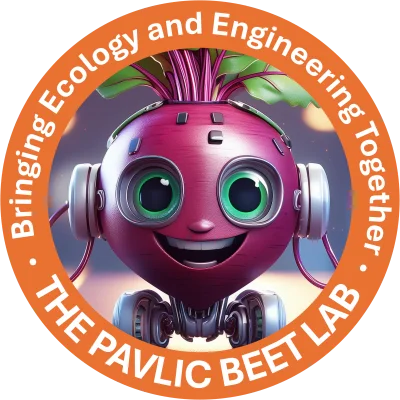

# BEET Lab: Bringing Ecology and Engineering Together

  

[Ted Pavlic](https://github.com/tpavlic)'s lab at Arizona State University
studies how natural and engineered systems, from ant colonies to robot teams,
perceive their environment and make decisions autonomously. Research directions
include:

- Collective behavior and decision-making in social insects
- Computer vision and machine learning for studying animal behavior (e.g.,
  [Beyond Tracking](https://github.com/PavlicLab/SWARM2021_AROB_BeyondTracking))
- Bio- and brain-inspired AI (e.g.,
  [KCNet](https://github.com/PavlicLab/KCNet-2021-Hong))
- Distributed algorithms for multi-robot and other engineered systems

Repositories here archive code and data from lab papers. For publications and
opportunities to join the lab, see [pavliclab.org](https://pavliclab.org/).
